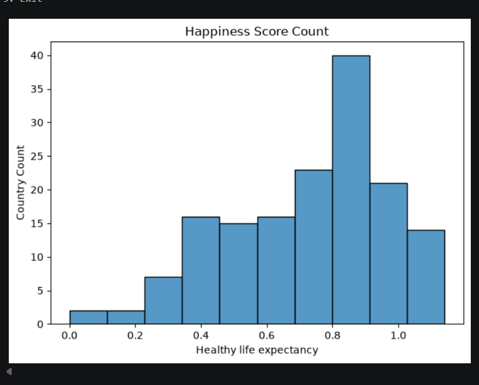
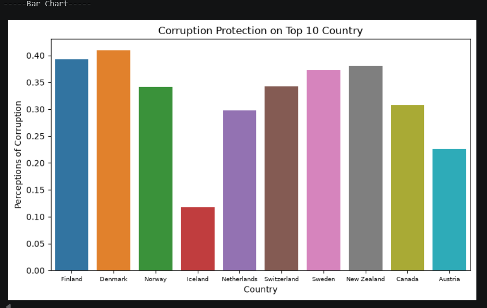
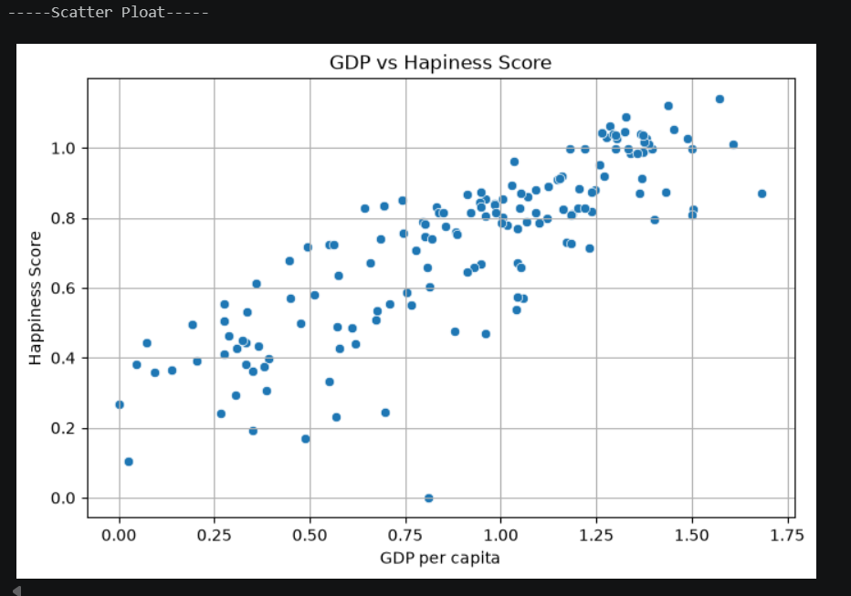

# 🌍 Global Happiness Report Analysis

> **A menu-driven Python program that visualizes the 2019 World Happiness Report data using Pandas, Matplotlib, and Seaborn.**

---

## 📌 Main Topic

**Data visualization and analysis of global happiness (2019).**
The project explores how factors such as GDP per capita, healthy life expectancy, and perceptions of corruption relate to the happiness of countries around the world.

---

## ✨ Features

| Option | Chart | What it shows |
|--------|-------|---------------|
| 1 | **Histogram** | Distribution of healthy life expectancy across countries |
| 2 | **Bar Chart (Top 10)** | Perceptions of corruption in the 10 happiest countries |
| 3 | **Bar Chart (Bottom 10)** | Perceptions of corruption in the 10 least happy countries |
| 4 | **Scatter Plot** | Relationship between GDP per capita and happiness score |
| 5 | **Exit** | Closes the program |

---

## 📸 Screenshots

### 1️⃣ Histogram – Healthy Life Expectancy
Shows how healthy life expectancy is distributed across countries. Most countries cluster around 0.8–0.9.



### 2️⃣ Bar Chart – Corruption Perception (Top 10 Countries)
Compares perceptions of corruption among the 10 happiest countries.



### 4️⃣ Scatter Plot – GDP vs Happiness Score
Shows a clear positive relationship: as GDP per capita increases, happiness tends to increase too.



---

## 🛠️ Technologies Used

- **Python 3.8+**
- **Pandas** – loading and sorting the dataset
- **Matplotlib** – plotting and figure control
- **Seaborn** – statistical charts (histogram, bar, scatter)

---

## 📂 Project Structure

```
Final_Exam/
├── 2019.csv              # World Happiness Report 2019 dataset
├── main.py               # Main program (menu + charts)
├── screenshots/          # Output screenshots used in this README
│   ├── histogram.png
│   ├── bar_chart_top10.png
│   └── scatter_plot.png
└── README.md             # Project documentation
```

---

## 📊 Dataset

The program uses **`2019.csv`** (World Happiness Report 2019), which contains these columns:

- `Overall rank`
- `Country`
- `Score`
- `GDP per capita`
- `Social support`
- `Healthy life expectancy`
- `Freedom to make life choices`
- `Generosity`
- `Perceptions of corruption`

---

## ⚙️ Installation

1. **Clone or download** this project.
2. **Install the required libraries:**

```bash
pip install pandas matplotlib seaborn
```

3. **Update the CSV path** in the code to match your computer:

```python
data = pd.read_csv(r"D:\Python\Project\Final_Exam\2019.csv")
```

---

## 🧠 Key Insights You Can Explore

- Countries with higher **GDP per capita** tend to report higher **happiness scores**.
- Top-ranked countries generally show **lower perceived corruption** problems than bottom-ranked ones.
- **Healthy life expectancy** is spread across a wide range, with most countries clustering in the higher values.

---

## 🚀 Possible Improvements

- Add a correlation heatmap of all factors
- Let the user choose how many countries to show (Top N / Bottom N)
- Save charts as image files
- Compare multiple years of the report

---


## 📄 License

This project is for educational purposes.
