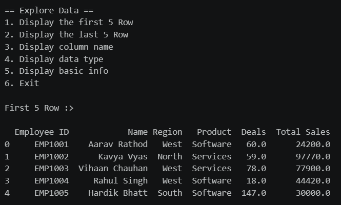
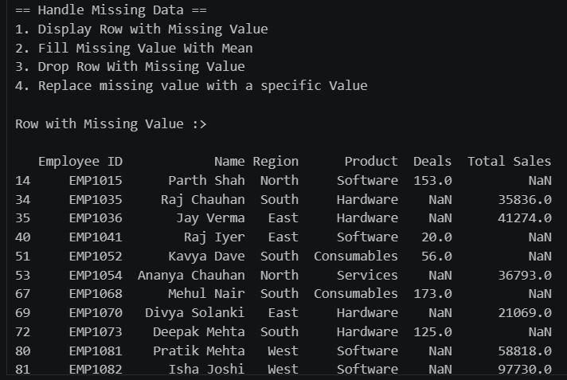
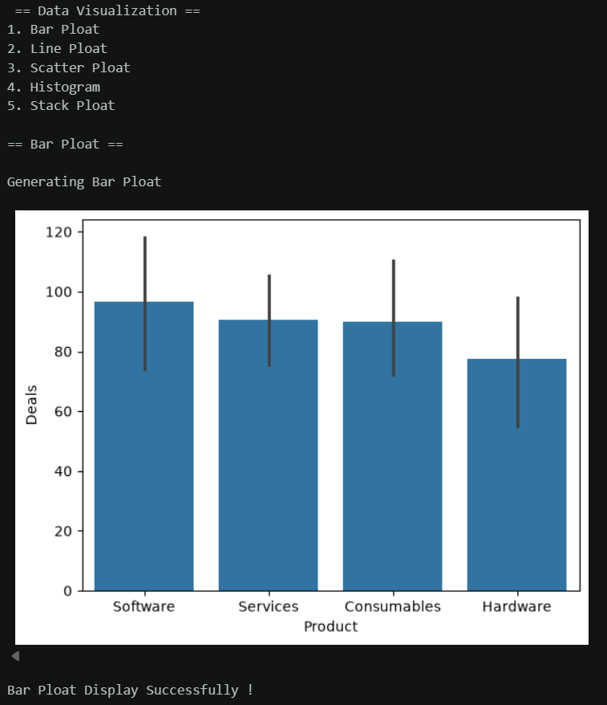

<div align="center">

# 📊 SALES DATA ANALYSIS & VISUALIZATION

### ⭐ A Python CLI tool to load, clean, analyze, and visualize sales data from CSV files ⭐

<br>

<table align="center">
  <tr>
    <td align="center" width="170">
      <br>
      <b>Python 3.8+</b>
    </td>
    <td align="center" width="170">
      <br>
      <b>pandas</b>
    </td>
    <td align="center" width="170">
      <br>
      <b>matplotlib</b>
    </td>
    <td align="center" width="170">
      <br>
      <b>seaborn</b>
    </td>
  </tr>
</table>

</div>

---

> ## 🎯 **Main Topic: Data Analysis & Visualization of Sales Data**
>
> A **menu-driven, command-line** Python program that lets you **load → explore → clean → analyze → visualize** sales data from a CSV file. Built with **pandas**, **matplotlib**, and **seaborn**.

---

## ✨ Features

- **Load Dataset**: Load any CSV file by entering its path
- **Explore Data**: View the first/last 5 rows, column names, data types, and basic info
- **DataFrame Operations**: Sort and filter data by `Total Sales` or `Deals`
- **Handle Missing Data**: Display, fill (mean or custom value), or drop rows with missing values
- **Descriptive Statistics**: Generate summary statistics using `describe()`
- **Data Visualization**: Create Bar, Line, Scatter, Histogram, and Stack plots
- **Save Visualization**: Export the last generated chart as `Visualization.png`

---

## 📁 Dataset Format

The sorting and filtering options expect these columns in your CSV:

| Column        | Description                     |
|---------------|---------------------------------|
| `Total Sales` | Total sales amount              |
| `Deals`       | Number of deals closed          |

Other columns (such as `Region` or `Product`) can be included and used for visualizations.

**Example:**

```csv
Region,Product,Deals,Total Sales
North,Laptop,25,50000
South,Phone,40,32000
East,Tablet,18,21000
West,Laptop,30,61000
```

---

### 1. Load Dataset
Reads a CSV file into a pandas DataFrame. You must do this first. All other options require a loaded dataset.

### 2. Explore Data
A sub-menu to inspect your data:
- First 5 rows
- Last 5 rows
- Column names
- Data types
- Basic info (`DataFrame.info()`)

<p align="center">
  
</p>

### 3. Perform DataFrame Operation
- **Sort** by `Total Sales` or `Deals`
- **Filter** rows where `Total Sales` or `Deals` is greater than a value you enter

### 4. Handle Missing Data
- Display rows with missing values
- Fill missing numeric values with the column **mean**
- **Drop** rows containing missing values
- Replace missing values with a **specific value**

<p align="center">
  
</p>

### 5. Generate Descriptive Statistics
Displays count, mean, std, min, quartiles, and max for numeric columns.

### 6. Data Visualization

| Plot       | Inputs                         |
|------------|--------------------------------|
| Bar Plot   | X-axis column, Y-axis column   |
| Line Plot  | X-axis column, Y-axis column   |
| Scatter Plot | X-axis column, Y-axis column |
| Histogram  | X-axis column                  |
| Stack Plot | X-axis column, Two data column |

Column names must match your CSV headers exactly (case-sensitive).

<p align="center">
  
</p>

---

## 💡 Example Workflow

```
1. Load Dataset            →  sales_data.csv
4. Handle Missing Data     →  Fill missing values with mean
5. Descriptive Statistics  →  Review the summary
3. DataFrame Operation     →  Sort by Total Sales
6. Data Visualization      →  Bar Plot (X: Region, Y: Total Sales)
7. Save Visualization      →  Visualization.png
8. Exit
```

---

## 🧯 Error Handling

The program handles common input problems without crashing:

- Non-numeric menu input → *"Invalid Input! Enter Valid Value"*
- Wrong file path → *"File Not Found Please Check It!"*
- Invalid column name → *"Enter The Valid Name"*
- Using features before loading data → *"Load Dataset First"*

---

## 📂 Project Structure

```
.
├── main.py            # Main program
├── screenshots/       # Screenshots used in this README
│   ├── explore_data.png
│   ├── missing_data.png
│   └── bar_plot.png
├── Visualization.png  # Generated when you save a chart
└── README.md
```

---

## 🔮 Possible Improvements

- Support for more chart types (pie, box, heatmap)
- Let users choose which columns to sort/filter by
- Export the cleaned dataset to a new CSV
- Support multiple data series in stack plots

---

## 📄 License

This project is open source. Add your preferred license here (e.g., MIT).