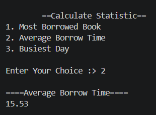
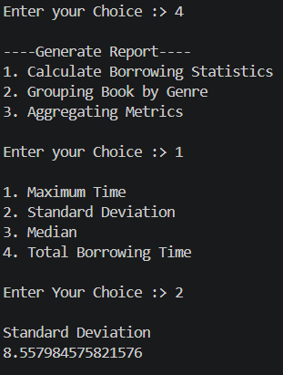

<div align="center">

# 📚 E-LIBRARY DATA INSIGHTS DASHBOARD

### ⭐ A Python CLI tool to load, analyze, filter, and visualize library borrowing data from CSV files ⭐

<br>

<table align="center">
  <tr>
    <td align="center" width="170">
      <br>
      <b>Python 3.8+</b>
    </td>
    <td align="center" width="170">
      <br>
      <b>NumPy</b>
    </td>
    <td align="center" width="170">
      <br>
      <b>pandas</b>
    </td>
    <td align="center" width="170">
      <br>
      <b>matplotlib</b>
    </td>
    <td align="center" width="170">
      <br>
      <b>seaborn</b>
    </td>
  </tr>
</table>

</div>

---

> ## 🎯 **Main Topic: Data Analysis & Visualization of Library Transactions**
>
> A **menu-driven, command-line** Python program that lets you **load → calculate → filter → report → visualize** library borrowing data from a CSV file. Built with **NumPy**, **pandas**, **matplotlib**, and **seaborn**.

---

## ✨ Features

- **Load Dataset**: Load `library_transaction.csv` into a pandas DataFrame
- **Calculate Statistics**: Most borrowed book, average borrow time, and busiest day
- **Filter Transactions**: Filter by genre (case-insensitive) or by borrowing duration (less than / greater than)
- **Summary Report**: Maximum, standard deviation, median, total borrowing time, genre summary, and borrow count per book
- **Data Visualization**: Create Bar, Line, Pie, and Heatmap charts

---


## 📁 Dataset Format

The program expects a file named `library_transaction.csv` in the same folder as the script, with these columns:

| Column                      | Description                          |
|-----------------------------|--------------------------------------|
| `Book Title`                | Title of the borrowed book           |
| `Genre`                     | Genre of the book                    |
| `Borrowing Duration (Days)` | Number of days borrowed (numeric)    |
| `Date`                      | Date of the transaction              |


---

## 🧭 Menu Guide

### 1. Load Dataset
Reads the CSV file into a pandas DataFrame. You must do this first. All other options require a loaded dataset.

### 2. Calculate Statistics
- Most borrowed book
- Average borrow time
- Busiest day

<div align="center">

**📸 Example: Average Borrow Time**



</div>

### 3. Filter
- **By genre**: enter a genre name (not case-sensitive)
- **By borrowing duration**: enter a number of days, then choose less than (`<`) or greater than (`>`)

### 4. Summary Report
- **Borrowing statistics**: maximum, standard deviation, median, or total borrowing time
- **Group by genre**: total borrowings, average time, and total days per genre
- **Total borrowing by book**: how many times each book was borrowed

<div align="center">

**📸 Example: Standard Deviation of Borrowing Time**



</div>

### 5. Data Visualization

| Chart      | What it shows                                       |
|------------|-----------------------------------------------------|
| Bar Chart  | Top 5 most borrowed books                           |
| Line Chart | Average borrowing duration by month                 |
| Pie Chart  | Share of transactions by genre                      |
| Heatmap    | Transactions by genre and borrowing duration        |

Charts open in a separate window. Close the window to return to the menu.

### 6. Exit
Quits the program.

---

## 💡 Example Workflow

```
1. Load Dataset            →  library_transaction.csv
2. Calculate Statistics    →  Most Borrowed Book
3. Filter                  →  Genre: Fiction
4. Summary Report          →  Group by Genre
5. Data Visualization      →  Pie Chart
6. Exit
```

---

## 🖼️ Screenshots

| Calculate Statistics | Summary Report |
|:--------------------:|:--------------:|
|  |  |
| Average borrow time = **15.53** days | Standard deviation = **8.558** days |

---

## 🧯 Error Handling

The program handles common input problems without crashing:

- Non-numeric menu input → *"Enter Valid Value !"*
- Wrong file name or path → *"File Not Found Enter Valid File Name"*
- Menu number out of range → *"Invalid Choice !"*
- Using features before loading data → *"Please Load Dataset First !!"*

---

## 📂 Project Structure

```
.
├── library_dashboard.py       # Main program (rename to match your file)
├── library_transaction.csv    # Input dataset
├── screenshots/
│   ├── calculate_statistics.png
│   └── summary_report.png
└── README.md
```

---

## 🔮 Possible Improvements

- Support for more chart types (box plot, scatter plot)
- Let users choose the CSV file path at runtime
- Export filtered results and reports to a new CSV
- Add a date-range filter

---

## 📄 License

This project is open source. Add your preferred license here (e.g., MIT).